# PGO process flow, Phase 2 (detailed)

This page shows every stage a Pharma General Ontology (PGO) concept passes through in Phase 2 (2025 to 2026). For a short overview, read the [simplified flow](./PGO-process-phase-2.md). The Phase 1 process stays documented on the [project wiki](https://github.com/Pistoia-Alliance-Inc/Pistoia-Alliance-PGO/wiki/2024%E2%80%90PGO-process).

## Process diagram

```mermaid
graph TD

classDef actor fill:#ffffff,stroke:#555,stroke-width:2px
classDef step fill:#f0f0f0,stroke:#999,color:#222
classDef artifact fill:#d8d8d8,stroke:#666,color:#222
classDef repository fill:#dce8f5,stroke:#5588bb
classDef action fill:#ffffff,stroke:#999
classDef decision fill:#fff9c4,stroke:#999

subgraph EXT ["Feedback to source ontologies, stages 13 to 15"]
  direction LR
  e13["13: draft definition proposal"]
  e14["14: definition proposed to the source"]
  e15{"15: source response"}
  e15a["15a: accepted"]
  e15b["15b or 15c: ignored or declined"]
end

s1{{"Steering Committee"}}
s2{{"Expert Group"}}
s3{{"Project Management Office"}}
s10{{"Steering Committee: review, approval, and PGO identifier"}}
s10b{{"Steering Committee: approval for publication"}}

a0a["New core concept proposals"]
a0b["Phase 1 backlog: de-prioritized or incomplete concepts"]
a1["1: concept proposal"]
a2["2a: concept approved for expert input"]
a3["2b: concept deferred"]
a5["3: alignment preparation"]
a6["De-prioritized concepts"]
a6p["6: Steering Committee approval pending"]
a10["5: expert proposal formulated"]
a11["8b: output record authoring"]
c4["4: expert alignment meetings"]

a7c[["7c: examples and recommended sources collected"]]
a7ci[["Open questions tracked as issues"]]
a11a[["8a: internal record completion"]]
a11r[["9: output file under expert review"]]
a12rdf[["10: machine-readable file generated"]]
a12a[["12a: published, human-readable formats"]]
a12b[["12b: published, machine-readable formats"]]
a12c[["12c: republished with corrections"]]

gate{"8a gate check: minimum completeness"}
val{"11: automated validation"}

pub_gh[("PGO GitHub, public")]
pub_web[("PGO webpage")]

a0a --> a1
a0b --> a1
a1 --> s1
s1 -->|2a: scoping approved| a2
s1 -->|2b: deferred| a3

a2 -->|3: alignment preparation| a5
a5 --> s3
s3 -->|share template, request input| s2
s2 -->|raise and address issues| s3
s3 --> a10

s2 --> c4
c4 -->|4 and 5: meetings and issues| a10

a10 -->|5: expert proposal complete| a6p
a6p -->|6: submit to Steering Committee| s10

s10 -->|7a: approve definition| a7c
s10 -->|7b: return to experts| c4
s10 -->|defer| a3
s10 -->|de-prioritize| a6
s10 -->|13: propose to source ontologies| e13

a7c -->|7c: complete| a11a
a11a -->|raise issues| a7ci
a7ci -->|resolve issues| a11a
a11a --> gate
gate -->|8b: complete, proceed to output record| a11
gate -->|incomplete: return to 7c| a7c
a11 -->|9: expert review moderated by the PMO| a11r
a11r -->|10: generate machine-readable file| a12rdf
a12rdf --> val
val -->|11a: passed| s10b
s10b -->|approved for publication| a12a
s10b -->|revision required| a11
val -->|11b: failed, revise| a11

a12a -->|12b: generate machine-readable formats| a12b
a12a -->|corrections identified| a12c
a12b -->|corrections identified| a12c
a12c -->|12c: republished| a12a

e13 -->|14: submit| e14
e14 --> e15
e15 -->|15a: accepted| e15a
e15 -->|15b or 15c: ignored or declined| e15b
e15a -->|update recommended sources| a7c

a12a -.->|12a: published| pub_gh
a12a -.->|12a: published| pub_web
a12b -.->|12b: published| pub_gh
a12b -.->|12b: published| pub_web
a12c -.->|12c: published| pub_gh
a12c -.->|12c: published| pub_web

class s1,s2,s3,s10,s10b actor
class a0a,a0b,a1,a2,a3,a5,a6,a6p,a10,a11,e13,e14,e15a,e15b step
class a7c,a7ci,a11a,a11r,a12rdf,a12a,a12b,a12c artifact
class pub_gh,pub_web repository
class c4 action
class gate,val,e15 decision
```

Solid arrows show the process flow. Dashed arrows show where outputs are published.

## Stages

PMO stands for Project Management Office, the Pistoia Alliance ontologies project managers.

| Stage | Description | Who | Output |
| --- | --- | --- | --- |
| 1 | Concept proposal, new or re-entering from the Phase 1 backlog | Steering Committee, Expert Group, PMO | Proposal |
| 2a | Concept approved for expert input | Steering Committee, PMO | Candidate list |
| 2b | Concept not prioritized or deferred | Steering Committee, PMO | Pending list |
| 3 | Alignment preparation: definition request template ready, meetings scheduled, invitations sent, offline expert input open | PMO | Template and invitations |
| 4 | Ongoing expert alignment | Expert Group, PMO (facilitation) | Alignment notes and issues |
| 5 | Expert proposal formulated | Expert Group, PMO | Expert proposal and recommendations |
| 6 | Steering Committee approval pending: dossier submitted | PMO | None |
| 7a | Steering Committee approved the definition, and the concept receives its PGO identifier | Steering Committee | Decision |
| 7b | Proposal returned to the experts | Steering Committee, PMO | Request for more input |
| 7c | Examples and recommended sources are collected, and questions are raised and resolved as issues | Expert Group, PMO | Examples and recommended sources |
| 8a | Internal record completion: finalize and sign off the internal concept record, then check minimum completeness. If incomplete, return to 7c | Expert Group, PMO | Internal concept record |
| 8b | Output record authoring: produce the clean production Markdown file from the approved content | Expert Group, PMO | Output Markdown file |
| 9 | Output file under expert review, moderated by the PMO | Expert Group, PMO | Reviewed output file |
| 10 | Machine-readable file generated from the Markdown file | PMO | RDF file |
| 11a | Automated validation passed. The checks also confirm contributor consent | PMO | Validated file |
| 11b | Validation failed, revision required: return to 8b | PMO | Return to 8b |
| 12a | Published in human-readable formats: Markdown pages and tables (CSV and Excel) | PMO | PGO GitHub (public), PGO webpage |
| 12b | Published in machine-readable formats: SKOS in RDF/XML, Turtle, and JSON-LD. Cumulative: implies 12a is complete | PMO | PGO GitHub (public), PGO webpage |
| 12c | Republished with corrections. The definition stays unchanged, so no new Steering Committee vote is required. The concept returns to 12a or 12b | PMO | PGO GitHub (public), PGO webpage |
| 13 | Draft definition proposal to the source ontology | PMO, Expert Group | Draft document |
| 14 | Definition proposed to the source ontology | PMO | Submitted proposal |
| 15a | Source ontology accepted the proposal | None | Confirmation from the source |
| 15b | Source ontology ignored the proposal | None | No response recorded |
| 15c | Source ontology declined the proposal | None | Decline recorded |

Resource Description Framework (RDF), Simple Knowledge Organization System (SKOS), and JSON for Linked Data (JSON-LD) are the machine-readable formats. CSV stands for comma-separated values.

## Key changes from Phase 1

- **Starting points:** Phase 2 draws from two sources, newly proposed core concepts and the Phase 1 backlog (concepts that were de-prioritized or not completed in Phase 1).
- **Alignment scope:** expert alignment covers definitions only. Examples and recommended sources are collected after the Steering Committee approves the definition (stage 7c).
- **Concept authoring:** concepts are authored as structured Markdown files, with an explicit expert review (stage 9) before the machine-readable files are generated.
- **Production pipeline:** Markdown, expert review, machine-readable file generation, automated validation, and publication in two stages (12a human-readable, 12b machine-readable).
- **Corrections after publication:** stage 12c republishes corrections to an already published concept when the definition stays unchanged. No new vote is required.
- **Feedback to source ontologies:** PGO can propose its approved definitions back to the external ontologies they come from, and the responses are tracked (stages 13 to 15).
