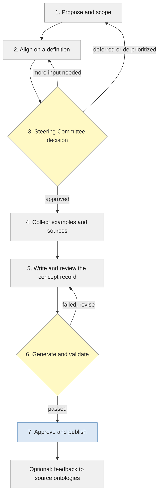

# How PGO concepts are developed (Phase 2)

Phase 2 of the Pharma General Ontology (PGO) ran from 2025 to 2026. This page shows in seven steps how a concept travels from proposal to publication. The [detailed flow](./PGO-process-phase-2-detailed.md) shows every stage. The Phase 1 process stays documented on the [project wiki](https://github.com/Pistoia-Alliance-Inc/Pistoia-Alliance-PGO/wiki/2024%E2%80%90PGO-process).

Phase 1 authored concepts with the Linked Data Modeling Language (LinkML). Phase 2 moved to Markdown records and a Simple Knowledge Organization System (SKOS) vocabulary.

## Who does what

- **Steering Committee:** scopes the work, approves definitions, and approves publication. It decides by vote.
- **Expert Group:** experts from the sponsor companies and other Pistoia Alliance ontology experts. They propose and align on definitions.
- **Project Management Office (PMO):** the Pistoia Alliance ontologies project managers. They facilitate the meetings, keep the records, and build and publish the outputs.

## The process in seven steps

1. **Propose and scope.** New concepts and unfinished concepts from Phase 1 are proposed. The Steering Committee decides which ones to take up now and which ones to defer.
2. **Align on a definition.** Experts collect candidate definitions and sources, discuss the pros and cons in alignment meetings, and formulate a recommendation. They prefer reusing an existing authoritative definition over writing a new one.
3. **Decide.** The Steering Committee approves the recommendation, asks the experts for more input, defers the concept, or de-prioritizes it. When it approves a definition, the concept receives its PGO identifier.
4. **Collect examples and sources.** For each approved definition, experts collect examples and recommended sources. Open questions are tracked as issues until they are resolved.
5. **Write and review the concept record.** The concept record is written from the PGO template, checked for completeness, and reviewed by the experts. The PMO moderates the review.
6. **Generate and validate.** The machine-readable vocabulary is generated and validated automatically. The automated checks also confirm that every named contributor has given consent. A failed check sends the record back to step 5.
7. **Approve and publish.** The Steering Committee approves the concept for publication. The PMO publishes the human-readable formats first (Markdown pages and tables) and then the machine-readable formats (SKOS in RDF/XML, Turtle, and JSON-LD) on the public PGO GitHub repository and the PGO webpage. Corrections that leave the definition unchanged are republished without a new vote.

After publication, PGO may propose its approved definitions back to the external ontologies they come from. The responses (accepted, ignored, or declined) are recorded.

RDF stands for Resource Description Framework, and JSON-LD is JSON for Linked Data.
